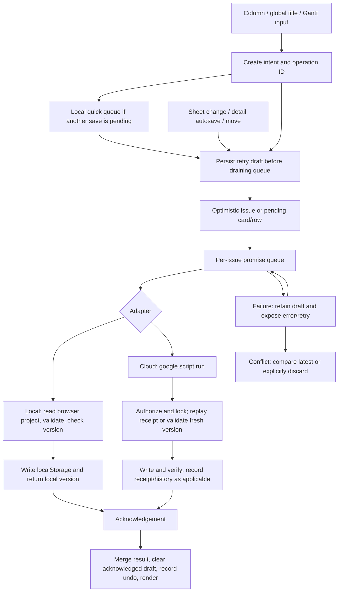

# GSheetJira MVP — Phase 0 review

**Reviewed:** 2026-10-28, Europe/Bratislava  
**Branch:** `implement_mvp` — verified; never switched  
**Application/test baseline:** `8258627a06f823f3caad97ca31d75865f946d9ac` (`init and added docs and AGENTS.md`)  
**Final HEAD:** `6a2b41438bcb902fe30deebf4840fd557b8e44ea` (`swimlanes update`) — the user's five-document update arrived during this audit; application/test sources are unchanged  
**Status:** Audit complete; implementation requires approval. No application, schema, dependency, authentication or deployment changes are proposed as part of this document.

## 1. Decision requested

Approve **R1: distinct operation identities for distinct edits, with safe acknowledgement handling** as the first small coding task. This pulls a narrow part of P2.1 ahead of the visual foundation because Phase 0 reproduced silent loss of a later edit. The working agreement places data safety before UX sequencing. Then proceed with the small slices in section 8, beginning with recovery and the design foundation.

The existing app is substantially ahead of the MVP plan's assumed baseline. Inline Kanban/Gantt creation, pending cards, local drafts, per-issue queues, basic conflict comparison, saved views, bulk changes, duplication/undo, swimlanes and recursive Task/Bug nesting already exist. Preserve them. The principal missing product capabilities are compact creation and direct card property editing; the principal weaknesses are save correctness, keyboard continuity, content density, mobile overflow and measured performance.

The new PRD's complete P0 acceptance is **not met**. A passing existing suite does not cover all of its failure and interaction requirements.

**Confirmed product decision:** Epic-based Kanban swimlanes are **required MVP P1 functionality** (FR-05, AT-13, P3.5). “Optional” describes the user's choice between flat and Epic grouping; delivery of the capability is mandatory. Include persistent grouping, collapsible lanes, No Epic, aligned statuses, contextual add, task counts, Epic-wide leaf-work completion and safe status/Epic movement with non-drag alternatives. Advanced assignee/project grouping, nested swimlanes and new lane-reordering machinery remain deferred. The five updated companion documents have been read and this review follows their corrected requirements.

## 2. Audit boundary and evidence

Read the repository [AGENTS.md](../AGENTS.md), [MVP PRD](PRODUCT_REQUIREMENTS_MVP.md), [UX specification](UI_UX_DESIGN_SPEC.md), [MVP plan](IMPLEMENTATION_PLAN_MVP.md), [future roadmap](FUTURE_ROADMAP.md), [legacy mapping](LEGACY_SCOPE_MAPPING.md), and the existing [readme](../readme.md), [requirements](../ProductRequiremtns.md) and [implementation review](../IMPLEMENTATION_PLAN.md). Inspected the shell, CSS, client rendering/events/persistence, shared model, server save/trigger paths, supporting repository/history/batch modules, build and browser/Node tests.

The initial working tree was clean. The specification's reference commit `7a2609d` is not current HEAD. All checks used this checkout. The build regenerated `CoreScript.html` and `dist/index.html` with **no tracked content differences**. The user's later commit changed only the PRD, UX specification, MVP plan, roadmap and scope mapping, so the application test baseline remains valid. This review is the only intended Git change made by this audit. This agent did not create/switch branches, commit, push or merge. No Google Sheet or Apps Script deployment was accessed or changed.

Evidence labels used below:

- **Observed:** reproduced in an isolated Edge browser using local sample/synthetic data.
- **Source:** directly visible in current source; a live-service outcome is not implied.
- **Existing tests:** executed in this review, with synthetic browser data or mocked Apps Script services.
- **Not verified:** requires a later test, additional engine/device, or separately authorized Google environment.

Local evidence is in the ignored `.playwright-mcp/phase0/` directory: audit, benchmark, small-data smoke and swimlane probe scripts/JSON plus viewport screenshots. These are audit artifacts, not product code or new committed tests. Their essential results and reproduction instructions are recorded here so this review remains useful without the ignored files. The scripts use disposable browser contexts and temporary localhost servers, with no Google credentials.

## 3. Current implementation and specification drift

| Area | Current evidence | Consequence for the MVP |
|---|---|---|
| Visual system | `Styles.html:2` already has neutral surfaces and cobalt blue `#2563EB`, not the older olive palette. Body is 13px, but many controls/metadata are 8–11px. | Refine existing semantic tokens toward the approved indigo palette; do not describe this as replacing an olive application. |
| Runtime | Dependency-free built frontend; existing development dependency `@playwright/test`. `scripts/build.mjs` validates and combines the sources. | No framework or new dependency needed. Preserve both template and standalone builds. |
| Data | 21 legacy fields remain in `Core.js`; optional active v2 repository, `taskTypeId`, comments, operational receipts and history also exist. | “21 columns only” is not a complete description of existing compatibility. Preserve active legacy **and already activated v2** behavior without activating, removing or migrating anything. |
| Hierarchy and ordering | Task/Bug nesting, Epic swimlanes, Sheet reparenting and Gantt hierarchy movement already exist. Sheet move intents explicitly get fresh operation IDs. | Epic Kanban grouping is now expressly mandatory. Preserve rank/hidden siblings/derived dates, correct silent Story-child detachment and implement the clarified leaf-progress semantics. No schema expansion. |
| Saving | `persist()` uses optimistic drafts/per-record queues, not a blanket full-screen save lock. Refresh and some bulk/destructive operations still use `setBusy()`. | Do not redo an obsolete global-lock refactor. Fix the observed queue bug and targeted rendering. |
| Server reads | Standard saves use a locked snapshot and targeted row verification. Personal legacy saves can atomically batch task/category/receipt changes. | Old whole-register reread claims are partly stale. Broad initial reads and standard write/journal separation remain; measure before backend changes. |
| Toolchain | AGENTS mentions Node 18+, while current readme requires Node 20+. Actual verification used Node 25.9.0. | Align documentation in a later small docs slice; no Node 18/20 compatibility claim is made here. |
| Branch instructions | Plan suggests a new feature branch; this task explicitly names `implement_mvp` and forbids switching. | Stay on `implement_mvp`; user's instruction takes precedence. |
| Legacy scope | Old completion gates include agent APIs, claims, capacity and migrations. | Those gates do not apply to this MVP. No agent workflows or new schema/workflow/authentication work. |

Unresolved product choice: approve the safety-first reordering of P2.1 before P1.1. The preservation approach above follows the explicit no-regression rule; it does not promote legacy features into new MVP work.

The earlier Epic-swimlane deferral conflict is **resolved** by the user's decision and commit `6a2b414`. A narrower presentation choice remains: the new UX text calls the flat board the default, while current `state.swimlanes` defaults to true. Preserve existing saved preferences; make the first-use default explicit in P3.5 rather than resetting existing users.

## 4. Requirements assessment

“Implemented” below means the named behavior exists with the stated evidence; it is not a production release certification. “Partial” means a usable implementation exists but some acceptance remains open.

| Requirement | Status | Existing behavior and remaining acceptance |
|---|---|---|
| FR-ENV — local, Apps Script, native Sheets | Partial verification | Shared Core and separate adapters, truthful browser-demo label, legacy/v2 server and native-edit mock tests. Live Google round trips/triggers not run. No local↔Sheets sync exists or is promised. |
| FR-01 — workspace/navigation | Partial | Three working routes and current-view indicators. Duplicate sidebar/tabs, large hero/statistics, always-expanded filters and saved-view bar consume the first screen. AT-10/11 and content-first layout remain open. |
| FR-02 — inline add | Partial | Title+Enter and consecutive entry in columns; pending/queued/failed cards with retry, context and lost-ack coverage. Shared title bar provides Sheet creation. Global input does not inherit the selected Epic; pending Sheet creates lack the board's per-item recovery surface. Enter does not guard IME; Escape does not cancel column input. |
| FR-03 — compact create | Missing | New/N opens the full 570px, full-height drawer with 18 input/select/textarea controls. No compact modal, More options handoff or compact validation flow. AT-02 unmet. |
| FR-04 — detailed editor | Partial | Existing fields, autosave, comments, children, validation, explicit delete and undo/duplicate support. Fields are a long undifferentiated form; save races/recovery remain. Native dialog trap and empty-dialog focus return passed a small smoke check. |
| FR-05 — Kanban, including mandatory Epic grouping | Partial | Status/rank drag, Epic grouping, collapse/flat preference persistence, No Epic, Alt+arrows and contextual creation exist. Direct priority/assignee edits are missing. Progress counts filtered parent+child records, not all Epic leaf work; Story-child drop protection and non-drag cross-Epic moves are incomplete. AT-03 and AT-13 unmet; AT-07 needs broader failure coverage. |
| FR-06 — Sheet | Partial | Editable selects/text, sorting, sticky header, column choices, hierarchy, bulk selection and CSV. No pinned identity/title column; Tab after a changed cell loses focus to BODY. Retained failed draft survives reload but Retry disappears. AT-05/08 incomplete. |
| FR-07 — Gantt | Implemented preservation baseline; verification partial | Source retains day/week windows, date drag/right resize, progress, dependencies, weekend/today, unscheduled/out-of-window access, Epic summaries and hierarchy. A supplemental local pointer smoke verified +1-day move, +1-day due-date resize and reload persistence; four SVG paths remained. Cloud scheduling/geometry edge cases still need coverage. |
| FR-08 — search/filter/context | Partial | Shared `filtered()` searches ID/title/description and more; all requested filters plus priority/tags/date bounds, removable chips/reset and personal saved views exist. Per-view scroll/focus and ordinary unsaved filter state across reload are incomplete. Preserve query semantics while simplifying presentation. |
| FR-09 — keyboard | Partial | N, /, 1/2/3 and dialog Esc exist; controls and modifier keys are excluded by global shortcuts. Ctrl/Cmd+K is missing. No composition guard in create/global handlers; Sheet keyboard continuity fails. Inline Esc behavior and shortcut help need completion. |
| FR-10 — persistence/integrity | Partial, release blocker | Stable IDs, model/server validation, locks, revision checks, drafts, retry receipts and comparison exist. Rapid-edit loss is reproduced; reload hides recovery actions; no client timeout in `rpc()`; failure/conflict status is not consistently differentiated. AT-05/06/10 remain open. |
| FR-11 — appearance/accessibility | Partial | Neutral tokens, labels, native dialogs, focus styles and reduced-motion rule exist. Tiny controls, mobile document overflow, duplicate navigation and no comfortable-density default. Full contrast, zoom/reflow, screen-reader and touch checks outstanding. |
| FR-12 — speed | Partial | Shared loaded collection, 700ms detail text debounce, lazy comments and optimized server paths exist. Full active-view/filter/sidebar/stats rebuilds, duplicate route renders and repeated graph work remain. Baseline results in section 7; no live save-speed certification. |

Existing P2/legacy capabilities (saved views, bulk operations, duplication, comments, and Sheet/Gantt grouping) remain in regression scope. Kanban Epic swimlanes are a mandatory P1 acceptance item, not merely a legacy preservation item. No additional dashboard, WIP, work calendars, arbitrary fields, agent controls or new statuses are recommended.

## 5. Create/edit/save paths and state ownership

**Standalone:** `Client.html:203–345` reads `sheetflow.project.v1`, validates every stored issue, uses Core validation and a new local version on save, and writes browser storage. Successful completion means **Saved in this browser**. It does not call Google. Ordinary local `saveIssue` does not implement the cloud receipt replay path; selected batch/duplicate operations have local receipts.

**Apps Script:** `Client.html:221–222` invokes `google.script.run`. `Code.js:80–96,320–361` uses authorization, one request context, a script lock, receipt replay, fresh issue/version checks, Core validation, write and read-back verification. Personal legacy batching includes data and receipts in one Sheets API operation. Standard legacy/v2 writes and their subsequent journal are separate steps; do not generalize the personal writer's atomicity to every path. `moveIssue()` validates status/parent/rank together. Native Sheet edits do not participate in the application's script lock; version hashes and trigger validation reduce, but do not eliminate, concurrent direct-edit risk.

**Retry/conflict:** `showError()` offers Retry and, for matching conflict text, Compare with latest/Discard draft. Comparison loads latest data and asks before discarding; it is not a merge editor. Quick-create pending cards/rows retain their original identity through a failed or lost acknowledgement. The RPC promise has no client timeout/reconciliation state; a callback that never arrives can remain Saving and hold that issue's queue. Never add an automatic create retry without preserving/reconciling its original identity.

**Drafts:** persisted in browser-local `sheetflow.pending-drafts.v1`; quick queues, pasted batches, duplicate intent, UI preferences, saved views and undo have separate keys (`Client.html:38–68`). An existing issue's draft is overlaid during refresh. Draft storage is not a cloud backup. New full-form text is not persisted on each keystroke; autosave/submit creates the retry draft. Comments and some bulk form values have different state paths and need separate navigation/recovery checks.

**Rendering and context:** `render()` (`Client.html:824–864`) rebuilds filters, statistics, Epic navigation and active view via HTML replacement. It captures one general scroll region, with additional per-lane quick-entry focus/selection/scroll restoration and Gantt popup preservation. Sheet row selection and collapse state are in `state`; collapse/columns/swimlanes/label width persist to localStorage. General Sheet cell focus/caret is not restored. `setView()` renders immediately and changes the hash; the hashchange listener renders again (`Client.html:1484–1489`). The app has no independent scroll-position map for each view. Filters are shared in memory; saved views explicitly persist snapshots, while ordinary filter changes are not automatically restored on reload.

## 6. Defects and risks, ordered by impact

### D1 — P0: rapid edits can lose newer content while reporting success

**Observed with a held-response cloud adapter that implements the server's receipt replay rule.** Submit Sheet summary “First edit”; before acknowledgement submit “Second edit”; acknowledge both in order. The two requests had the **same operation ID**, with versions v1 then v2. The second receipt replay returned “First edit”. The visible title and synthetic server title ended as “First edit”, draft storage was empty, and the indicator read “Synced with Sheets”.

Confirmed separately with actual select-control interactions: choose High then Low before acknowledging either request. Both carried the same ID; after both acknowledgements, visible/server priority was High and no draft remained. This is not limited to the synthetic summary-change probe.

Cause: `persist()` (`Client.html:602–649`) selects an ID from `input.operationId` or an existing draft before allocating a fresh one; acknowledgement logic uses operation-ID inequality to recognize newer content. Distinct edits sharing that ID are indistinguishable from retries. Inline edits also spread the optimistic issue, including transient operation metadata. Server receipt replay (`Code.js:323–325`) correctly returns the original result for that identity. Sheet reparent/move code already supplies fresh IDs, explaining why its rapid-move regression passes.

Fix acceptance: each distinct edit intent has its own immutable operation/payload; retransmission of that same intent retains its ID; a late acknowledgement cannot clear or overwrite a newer draft. Test same-field and different-field edits, autosave plus manual Save, repeated edits after failure, and different issues saving concurrently. Preserve server revision checks. Do not “fix” this by removing deduplication.

### D2 — P0: failed inline drafts survive reload but recovery actions disappear

**Observed:** fail a Sheet edit; its value and draft remain and Retry is visible. Reload: the value still appears and the status says “Save unconfirmed”, but the error banner is hidden and Retry is absent. Opening the editor initially labels an existing issue “Saved”, even though its displayed fields may include a retained draft (`openIssue()` at `Client.html:1402`).

Cause: refresh overlays drafts and hides the banner; general edit failures are not reconstructed as an actionable per-issue state. Quick-create cards have stronger reload recovery than ordinary edits. Add explicit recovered-draft status and Retry/Copy/Compare/Discard entry points. Confirm latest remote version without silently rebasing an old full-record draft onto it.

### D3 — P0 reliability risk: incomplete ambiguous-save handling

**Source, not a live reproduction:** `QuickAdd.html` generates a new operation ID on every submit and retains only the title after failure. If a sidebar create commits but its acknowledgement is lost, submitting again can create a second issue. Standard server save paths can also commit data before a later journal/receipt failure (`Code.js:347–361`, `History.js`); a receipt-only retry strategy cannot prove exactly-once creation across that failure window. Personal legacy atomic writes are a narrower, stronger path.

Use a focused failure-injection slice to classify rejected, committed and unknown outcomes. First preserve sidebar operation identity/draft across an ambiguous response. Separately review any backend correction before implementation; no write-path refactor or schema change is approved by this review. Do not promise universal exactly-once semantics or silently retry with a new identity.

### D4 — P0/P1: creation and everyday editing exceed the approved interaction cost

**Observed/source:** New and N open the full drawer; common card priority/assignee have no editable controls; the detailed form exposes all advanced fields. Column creation already works and should be refined, not reimplemented. Compact create, grouped details and direct priority/assignee editing are independent slices, each built on the repaired save behavior.

### D5 — P1: keyboard, composition and focus regressions

- **Observed:** edit a Sheet summary then press Tab; after save/redraw `document.activeElement` is BODY, not the next cell.
- **Observed via synthetic composing key event:** column Enter with `isComposing: true` created a task and cleared the input. Source handlers for column/global quick entry do not guard composition.
- **Observed:** Escape leaves the column's unsent title unchanged; no cancel behavior is implemented there.
- **Observed small smoke:** empty New dialog trapped reverse Tab within the dialog; Escape closed it and returned focus to Create issue. Do not report all dialog behavior as broken. Failed/pending saves, child navigation and unsent comment text need wider coverage.
- **Source:** global shortcut guard excludes input/textarea/select and modifiers, but not composition/contenteditable; Ctrl/Cmd+K is absent. Cards have Alt+arrow alternatives, but those are not a complete touch-accessible Move menu.

### D6 — P0/P1 design: chrome precedes work; typography and mobile containment fail the target

Screenshots captured at **1366×768**, **1440×900**, **390×844**, all three views plus New:

| Observation | 1366×768 | 1440×900 | 390×844 |
|---|---:|---:|---:|
| Top of task content | y=611px | y=611px | y=836px |
| First Kanban card top | y=729px | approximately y=729px | y=954px |
| Board column width | 210px | 214px | 245px |
| Whole-document overflow, Kanban | 21px | 0px | 984px |
| Whole-document overflow, Sheet/Gantt | 0px | 0px | 100px |
| New dialog | 570px wide, full height | 570px wide, full height | Full screen |

The default sample contains 13 issues. On 1366×768 the first card title starts at approximately y=765, at the lower viewport edge. On mobile the task area is below essentially all initial content; board overflow expands the document rather than being fully contained within the board. Mobile retains a 62px icon sidebar. There are six view buttons for three views. The full-screen mobile editor itself is consistent with the target.

Computed card title is 12px, card ID/priority/due metadata 9px, Sheet inputs 11px, and Gantt label button 10px. Some move/add controls are roughly 17–21px wide. This falls below the spec's comfortable text/touch targets. Existing focus and reduced-motion CSS should be retained. A complete contrast/screen-reader/200% reflow audit was not performed.

Local screenshots: [desktop Kanban](../.playwright-mcp/phase0/kanban-1366.png), [wide Kanban](../.playwright-mcp/phase0/kanban-1440.png), [mobile Kanban](../.playwright-mcp/phase0/kanban-390.png), [desktop Sheet](../.playwright-mcp/phase0/sheet-1366.png), [desktop Gantt](../.playwright-mcp/phase0/gantt-1366.png), [New drawer](../.playwright-mcp/phase0/create-1366.png). Links refer to ignored local evidence, not committed assets.

### D7 — P1 speed: unnecessary work on rendering and local persistence

Source: all active-view DOM is recreated on edits and most controls; view navigation can render twice; search renders synchronously on every input event. `getLocal()` validates the full project on each adapter call, and `Core.validate()` constructs/maps/checks the whole hierarchy for each issue. Filtering and Epic ranges repeatedly traverse relationships. Sheet creates all cells/select options; none of the views is virtualized.

Prefer eliminating duplicate renders and repeated computation, then targeted updates with explicit focus/scroll ownership. Do not jump to virtualization, weaken validation, cache mutable server permissions/tasks, or refactor backend writes without evidence and dedicated tests.

### D8 — inherited integrity and recovery limits

**Source / not newly exercised live:** native Sheet writes are outside the script lock; ordering checks the moved issue rather than a shared ordering-scope revision; rank midpoint exhaustion and concurrent neighbor changes need stress tests. Browser storage can be unavailable/full, and several draft/queue writes are not guarded. Draft/undo keys are generic per origin rather than visibly scoped to a project/environment. Receipt retention is unbounded. Keep these in the risk register; investigate with bounded tests before choosing a change, and do not introduce a storage migration in a visual slice.

### D9 — required P1 / AT-13: Epic grouping is present but its safety and metrics need correction

**Observed on a seven-record local fixture:** two Epics, a Story under Epic One, two nested Tasks (one Done), a direct Done Task, and an unparented Task. No Epic contained the unparented task. Collapse and flat-grouping preference survived reload. These behaviors are implemented foundations to retain.

`renderSwimlaneHeader()` (`Client.html:947–957`) computes progress from filtered `lane.items`, including the parent Story. The fixture showed **4 items · 50% complete**; applying the Done filter changed it to **2 items · 100% complete**. The corrected requirement is **2 of 3 leaf work items Done, approximately 67%**, independent of filter. Visible counts should change with filters and be labeled separately from Epic-wide progress, including when collapsed and when there are zero leaves.

The Kanban drop handler (`Client.html:1764–1777`) assigns a non-Epic's parent directly to the target lane ID. An event-level dragstart/drop probe moved the unfinished Task from Story `PRJ-3` to Epic `PRJ-2` with status Review, without an explained detach confirmation. The preceding mouse drag probe did not move the item, so this is evidence of the **drop-handler safety defect**, not a successful physical drag acceptance test. The same assignment also risks flattening Story nesting for within-Epic status drops. Reject an unsupported move with a clear message or require an explicit explained detach/reparent action, as the new specification requires. Preserve a Story and its descendants when moving the Story itself.

There is no dedicated non-drag cross-Epic Move action. Existing Alt+arrows cover ordering/status, and full-detail Parent editing is available, but AT-13 needs a discoverable keyboard/touch path with the same safeguards. Implement these simple corrections without adding assignee/project grouping, an `epicId` column or a generic grouping engine.

## 7. Verification and performance baseline

| Command/check | Result |
|---|---|
| `git branch --show-current`, `git status --short`, `git log -1` | `implement_mvp`, initially clean, HEAD recorded above. |
| `npm.cmd run check` | Build succeeded; **100 tests passed**, 0 failed/skipped; Node runner reported approximately 1.53s. Includes model, CSV, mocked server legacy/v2, setup, migration, authorization, batching, revision and idempotency coverage. |
| `npm.cmd run test:browser -- --workers=2` | **39 passed in 48.4s**, installed Edge. Synthetic local/cloud adapters; no real Sheets. |
| `npm.cmd start` | Started the documented local demo on 127.0.0.1:4173. |
| Supplemental audit | Three viewport sets; save failure/reload/conflict; rapid same-record text/select changes; Sheet Tab/IME/Escape/dialog focus; local Gantt move/resize/reload; search count consistent at 4 of 13 across all views and filtered CSV download; mandatory Epic grouping/preferences/progress/drop-handler checks. Findings above; audit probes are not added to the regression suite. |
| Generated output | No tracked content diff after required build; Git warned only about configured LF/CRLF conversion. |

Sandbox note: the first browser-suite attempt could not reach localhost (`EACCES`) and was stopped; it is not counted as a pass. The approved local-process retry completed the full suite. Supplemental probes used temporary ports 4175–4178. No dependency installation was required.

### Measurement conditions and interpretation

Windows 10.0.26300; Intel Core i5-1145G7 @ 2.60GHz, 8 logical processors, approximately 15.71 GiB RAM; Node 25.9.0/npm 11.12.1; headless Microsoft Edge **156.0.4314.50**. Viewport 1440×900, default expanded Epic swimlanes, localStorage adapter, localhost, no CPU/network throttle, no simultaneous browser test suite. This is one workstation/session, not a fleet or live Google benchmark.

Deterministic datasets have **100 / 500 / 2,000 issue records**. Every block of 100 contains one Epic, five Stories and 94 Tasks/Bugs. Thus the largest case contains 20 Epics, 100 Stories and 1,880 Tasks/Bugs. They span all five statuses/priorities, eight assignees plus unassigned, three sprints, labels, 25% unscheduled records, varying dates/effort/progress, acyclic backward dependencies and occasional long descriptions. These are synthetic records, not user data. A later release benchmark should also include 2,000 task records plus their containers if “2,000 tasks” is interpreted strictly.

Navigation measures in-page click dispatch to two animation frames after synchronous work, including hashchange-driven rendering. Search alternates `design` and empty query. Edit measures a priority change event to two frames after the local save/render work. These are repeatable **interaction-to-frame proxies**, not physical click-to-photon or the earliest possible paint. Initial measurements start after fixture seeding, include application load/validation/render, and end after readiness plus two frames; browser launch and test harness setup are excluded. A small initial sample cannot establish a reliable p95 service objective. Raw samples are kept locally; release measurements should use browser performance/event timing and traces as well.

| Initial usable-board proxy (5 observations) | 100 records | 500 records | 2,000 records |
|---|---:|---:|---:|
| Median | 535ms | 806ms | 4,740ms |
| Observed range | 468–602ms | 740–873ms | 4,656–4,807ms |

| Loaded interaction proxy (20 observations each) | 100: p50 / p95 | 500: p50 / p95 |
|---|---:|---:|
| Navigate to Sheet | 562 / 653ms | 3,377 / 4,780ms |
| Navigate to Gantt | 152 / 200ms | 600 / 952ms |
| Navigate to Kanban | 127 / 158ms | 677 / 939ms |
| Search, alternating query/reset | 44 / 56ms | 187 / 308ms |
| Sheet priority edit through local save/render | 341 / 507ms | 3,262 / 6,055ms |

The 100-record Sheet already rendered 6,115 DOM elements and 1,089 editable cells. The <150ms navigation and <100ms local-feedback budgets are not demonstrated by this baseline; several measured ready-frame delays are far above them. The 2,000-record initial usable-board proxy also exceeded the <3s target.

**Bounded 2,000-record limitation:** the full navigation loop was curtailed after collecting initial-load samples. A separate reduced three-observation follow-up recorded two initial loads at 3,745 and 3,778ms, then was stopped after roughly three minutes without completing its planned Sheet-navigation series. Its partial navigation values were not exported, so no 2,000-record navigation/edit p50 or p95 is claimed. This is an incomplete stress run, not a passing benchmark or an estimate of one interaction's duration. The two initial-load ranges illustrate session variability; repeat with finer per-action tracing and incremental sample logging before choosing an optimization. Both sets used synthetic local data, and no source was changed.

**Not measured here:** real Apps Script acknowledgement percentiles, server lock contention/native Sheet races, physical mobile touch, another browser engine, full scroll/drag frame distributions, systematic cold-start performance, full accessibility conformance. The readme records previous small live samples around 2.5–3.9s, but those are historical evidence, not measurements from this audit and not proof of the <2s target.

### Required next benchmark/failure protocol

1. Freeze the fixture, browser/version, grouping, viewport and relevant machine load. Use 100/500/2,000 scales, long descriptions/dependencies, flat and grouped views. Record browser traces, payload size/DOM count and cold/warm initial time separately.
2. Use at least 30 observations per action after defined warmups: create, rename, priority/assignee, filter, each view switch, Sheet/Gantt scroll, board drag, Gantt move/resize. Report p50/p95 and failures, not just best time. Measure first feedback separately from acknowledgement.
3. In an isolated cloud adapter, hold callbacks for 2s/10s, reject before commit, commit then lose acknowledgement, return a stale-version conflict, deliver unrelated responses in reverse order, and never deliver a callback. Test rapid same/different-record edits and reload during each state.
4. Inject failures at data write, verification and receipt/journal boundaries in existing server mocks. Check data, ID allocation, original operation identity, draft retention and retry outcome, not only visible labels. Include localStorage quota/unavailability and malformed saved state.
5. After separate authorization for a verified **test** script/workbook, repeat local/cloud parity, native multirow edits, IDs/dates/hierarchy/order, version conflicts and transport serialization. Record source commit, mode, active schema and handler/network time separately. Do not call setup, migrate, activate v2 or deploy as part of ordinary UI checks.

## 8. Ordered, independently testable implementation slices

Every slice is a separate reviewable change. Run `npm.cmd run check`, relevant Edge cases and the full current browser suite before acceptance. Regenerate build-owned outputs; inspect their diffs. No slice grants permission to deploy, push, merge, change schema/authentication or add dependencies.

| Order / slice | Scope and affected source | Explicit acceptance | Exclusions / dependency |
|---|---|---|---|
| **1 — R1 (P2.1 safety prerequisite)** | Fix distinct edit/retry identities and acknowledgement ownership in `Client.html`; add browser failure/concurrency regressions, reusing existing mocks. | Two rapid same-field edits end with the second value and no lost draft; different fields accumulate; latest confirmed revision is used in order; retries reuse identity; ambiguous create does not duplicate; independent issues remain editable. Local and held-response cloud cases pass. | No styling, schema, backend rewrite or queue framework. Detailed first-task contract below. |
| **2 — R2 (P2.1 recovery)** | Rehydrate actionable failed/pending/conflict state for ordinary edits after reload; truthful editor status; copy/retry/compare/discard access. Primarily `Client.html`, small shell/CSS changes only as needed. | Fail/close/reload/reopen keeps exact draft and reachable recovery; never labels it Saved; latest remote value is not overwritten without conflict handling; one issue's success cannot hide another failure. | Depends on R1. No automatic merge or new synchronization model. |
| **2a — P3.5a mandatory swimlane move safety** | Correct Kanban Story-child parent handling and provide simple non-drag Epic/status moves in `Client.html`; minimal controls in `Styles.html` and focused browser tests. | Status-only moves retain Story parent; direct Epic children and Stories move legally; nested-child cross-Epic moves reject clearly or explicitly confirm detach; combined status/parent/rank save is recoverable; hidden sibling order and descendants persist after reload; delayed/failure/conflict tests pass. | Depends on R1/R2. Pull forward hierarchy safety, not a grouping rewrite. No new schema, assignee/project grouping or lane reorder engine. |
| **3 — P1.1 tokens and legibility** | Consolidate existing semantic CSS colors, type, spacing and focus for currently visible controls in `Styles.html`; keep existing semantic markers. | Desktop/mobile screenshots, body 13–14px and metadata 12–13px in touched surfaces, contrast/focus checks, reduced motion retained; no changed data/events. | No shell restructuring, backend edits or dark theme. |
| **4 — P1.2 workspace shell** | One responsive view navigation, compact topbar/New/save status, remove everyday hero/stat band; move existing advanced controls into accessible contextual placement. `Index.html`, `Styles.html`, minimal `Client.html` DOM-reference adaptation. | Three hashes and N,/ ,1/2/3 work; work visible at 1366×768; no whole-page horizontal overflow at 390px; filters, export, undo, saved views and Epic navigation remain reachable. | No new Overview/project management or feature removal; do not combine with persistence refactor. |
| **5 — R3 sidebar retry identity** | Preserve the same sidebar submission identity and title/context after an ambiguous response in `QuickAdd.html`; targeted fake-RPC test. | Commit-then-lost-response followed by retry creates once; changing the intended title starts a new intent; pending double-submit and reload recovery have explicit behavior. | No new sidebar features, backend changes or actual Sheet writes during local verification. |
| **6 — P2.3 compact Quick Create** | Separate New/N dialog from existing-issue drawer; optional fields and More options handoff in `Index.html`, `Client.html`, `Styles.html`. | Title-only Enter creates once; IME guarded; Ctrl/Cmd+Enter from multiline; draft survives handoff; trap/restore/Escape tested at desktop/mobile; validation accessible. | Depends on R1/R2 and foundation. No smart parsing, new fields or new shortcut aliases initially. |
| **7 — P2.4 details organization** | Group primary/planning/effort/metadata; preserve child/comments/duplicate/delete access. | All existing fields round-trip; delayed autosave, failed save, changing child and close/reopen retain work; accurate status/focus. | No new rich text/history/permission feature; no data-model changes. |
| **8 — P2.2/P2.6 inline refinement** | Keep existing column/Gantt entry; fix IME/Escape and legal context defaults; surface Sheet pending/error entries near quick-add. | Three consecutive titles create exactly once in correct context; unsent next title/focus stays; delay/failure/reload recover; global/Sheet creation honors selected Epic where legal. | Do not rebuild working batching, swimlanes or hierarchy. |
| **9 — P2.5/P3 direct card edits** | Priority first; assignee/status and accessible Move menu in subsequent independent increments. | Click/tap/keyboard changes property without opening/dragging card; pending/failure/conflict state retains content; refresh confirms result; card focus restored. | Use repaired persistence; no WIP or new workflows. |
| **9a — P3.5b mandatory swimlane presentation/metrics** | Refine the existing flat/Epic toggle and counts/progress; preserve No Epic/collapse/aligned columns/contextual add. `Client.html`, `Index.html`/`Styles.html` as needed; deterministic ancestry/leaf fixtures. | Pass AT-13: grouping preference persists across reload/views; explicit first-use default without resetting saved preference; No Epic membership uses ancestry; collapsed lane keeps progress; filtered visible counts differ clearly from overall Done/total leaf work; zero-leaf case works; 2,000-record grouping measured. | Required MVP P1, not deferred. Share safeguards from P3.5a; avoid duplicate Epic cards. No generic/nested/assignee/project grouping or schema migration. |
| **10 — P3.3 Sheet continuity** | Stable cell focus/caret and Tab/Enter/Escape; targeted updates; then pinned identity where feasible. | Edit several cells with delayed/out-of-order unrelated acknowledgements; correct next-cell focus; drafts preserved; sort/filter/selection/scroll/CSV and existing row moves pass. | No new spreadsheet engine, bulk expansion or ordering semantics. |
| **11 — P4.1/P4.3 navigation/filter continuity** | Remove duplicate route rendering, standardize composition/modifier guard/help, explicit per-view context; simplify filter UI preserving predicates. | Same matching IDs across views accounting for collapsed/container rendering; one-click reset; deep links/back-forward work; no typing hijack; no unrelated scroll/focus reset. | No shared saved views or query redesign. |
| **12 — P4.2 command palette (P1)** | Ctrl/Cmd+K for existing New/view/search/issue actions only. | Keyboard/mouse flow, accessible focus, escape and text-field handling tested; no dead commands. | After core focus/save correctness; may follow safe P0 acceptance. |
| **13 — P4.4/P4.5 Gantt and responsive polish** | Shared control styling, touch-reachable details/precise dates, constrained horizontal regions. | Day/week, date shift/right resize/reload, derived Epic schedule, dependencies, unscheduled items, vertical hierarchy and mobile editor remain correct. | No working days, holidays, milestones or automatic rescheduling. |
| **14 — P5 measured optimization/hardening** | First remove repeated graph/render work; assess targeted DOM updates; only then justify larger techniques. Add missing accessibility/failure/benchmark coverage. | Repeat section 7 with recorded before/after; no data/focus regression; document budget misses; approved test-Sheets smoke before release. | Backend optimization is a separate design/review; virtualization/dependencies require demonstrated need and applicable approval. |

P1.3 shared controls and P1.4 accessibility are acceptance work within each touched component, not permission for an all-at-once redesign. Optional density/dark mode/configuration remain P2; existing saved-view functionality remains supported. P3.5a/P3.5b and AT-13 are required for the full MVP even though a safe P0 slice can be accepted earlier. “Optional Epic grouping” must never be interpreted as optional implementation.

## 9. Recommended first coding task — reviewable contract

**Title:** `[P2.1 / R1] Preserve distinct rapid edit intents across queued saves`  
**Requirements:** FR-04, FR-06, FR-10; AT-04, AT-05, AT-06  
**Expected files:** `Client.html`, a focused new/existing `e2e/` spec, generated `dist/index.html`; existing server tests only if a stronger receipt fixture is needed. `CoreScript.html` should remain content-identical unless Core source actually changes, which is not planned.

1. Turn D1's held-acknowledgement reproduction into a failing regression before changing the queue. The mock must replay persisted receipts just like `saveIssueLocked_`, not blindly accept every payload.
2. Distinguish **new edit intent** from **retry of the same intent**. Allocate a fresh identity for new content, keep queued snapshots immutable and avoid inheriting transient identity from an optimistic issue. Keep same-operation retries stable.
3. Acknowledge only the matching saved draft. Preserve later edits and their order; serialize the issue against each confirmed revision. Do not overwrite newer server data or weaken conflict validation.
4. Verify same-field A→B, different-field changes, A failure then B, late A success, autosave/manual Save overlap, two different issues, and create lost-ack retry/reload. Check persisted value **and** visible value/draft/status.
5. Run build/Node and all current browser tests. Recheck local mode because it lacks ordinary cloud receipt replay. No visual, schema, authorization or deployment changes.

**Done means:** the second intent survives and persists, failed work stays recoverable, retries do not multiply creates, existing 100/39 suites still pass plus the new meaningful regressions, and generated diffs are reviewed. It does not mean Apps Script production verification has occurred. Any need to alter the server write contract should return as a separate, concrete proposal.

## 10. Approval and remaining release gates

Phase 0 is documentation/evidence only. Approval is requested for R1 and the safety-first sequence, not for all future work in one batch. The applicable requirement is [AGENTS.md](../AGENTS.md), Phase/release gates: **“Phase 0: baseline report, risk map, branch and test plan; no code changes until approved.”** The MVP plan likewise authorizes inspection/documentation only until the first code slice is approved.

Before full MVP release, resolve the reproduced P0 save and creation gaps, pass mandatory Epic swimlane AT-13 including leaf-work metrics and hierarchy-safe/non-drag moves, pass local and synthetic-cloud acceptance scenarios, record performance budgets honestly, complete accessibility/mobile checks, and obtain separate authorization for real test Apps Script/Sheets verification. Production deployment, schema activation/migration, new dependencies, authentication/sharing changes, push and merge remain separate explicit decisions. No agentic task workflow is part of the proposed MVP work.
